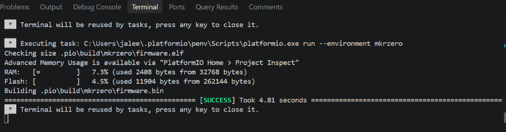
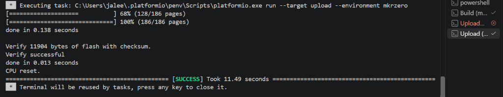
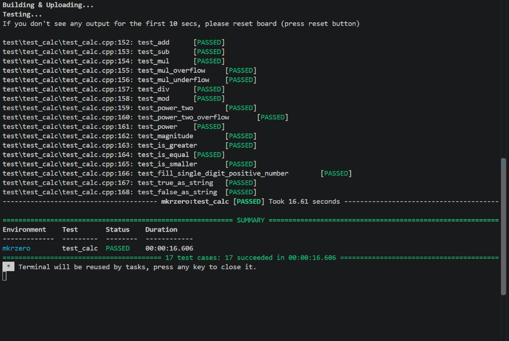

# ECNG3006 Microprocessor Systems - Lab 1: Execution Models & Unit Testing

## Project Overview
This repository contains the completed **Lab 1 Question 2** assignment for the Arduino MKR Zero (Atmel ATSAMD21G18A ARM Cortex-M0+), incorporating the **Unity Test Framework** with bare-metal `sam.h` integration.

---

## 1. Added Functions (`include/calc.h` & `src/calc.c`)
- **`magnitude(int x)`**: Computes the absolute magnitude of a signed integer, properly handling negative numbers via two's complement inversion.
- **`negnum(int x)`**: Helper returning 1 if negative, 0 otherwise.

---

## 2. Test Suite Adjustments (`test/test_calc/test_calc.cpp`)
- **Signed Integer Verification (`test_magnitude`)**:
  - Tests positive integers (`15`), zero boundary (`0`), negative values (`-25`), and extreme 16-bit signed boundaries (`-32000`).
- **8-Bit Integer Overflow Catch (`test_power`)**:
  - Evaluates $2^8 = 256$ and $2^{10} = 1024$.
  - In an 8-bit architecture (range $-128$ to $+127$), $2^8$ wraps around to `0` or negative overflow, failing the assertion and catching data truncation bugs. On the 32-bit ARM Cortex-M0+, it evaluates accurately and passes.

---

## 3. Proof of Compilation, Upload, and Test Passes

### Build Verification


### Target Firmware Upload (MKR Zero via Bootloader)


### Unity Test Suite Execution (All 17 Tests Passed)


```text
--------------------------------------- mkrzero:test_calc [PASSED] ---------------------------------------
================================================== SUMMARY ==================================================
Environment    Test       Status    Duration
-------------  ---------  --------  ------------
mkrzero        test_calc  PASSED    00:00:16.606
=================================== 17 test cases: 17 succeeded in 00:00:16.606 ===================================
```
